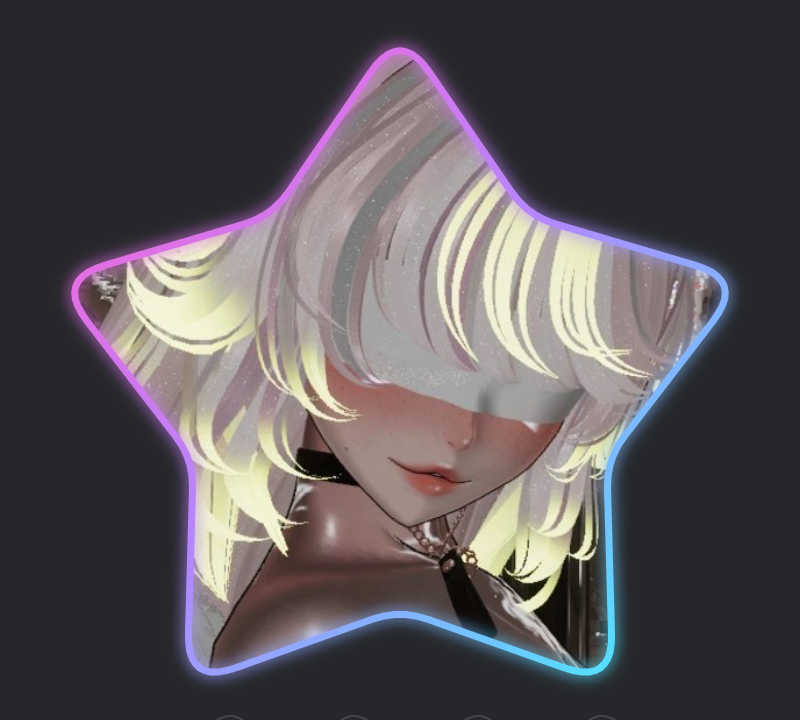
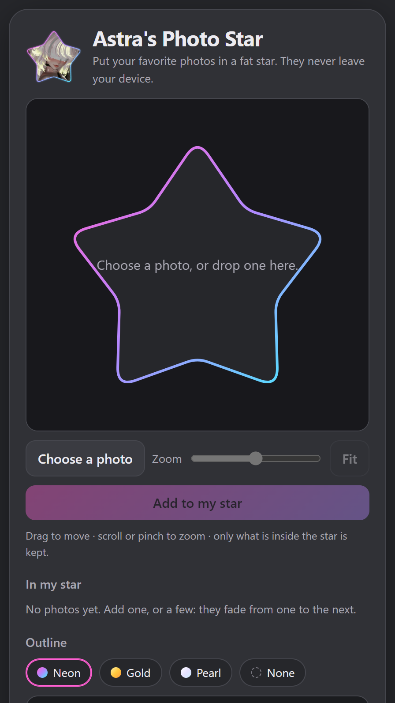

# Astra's Photostar

*By Astra.* Put your favorite photos in a fat neon star. Drag each photo until it sits right, then download your photo
star: a PNG, or an SVG that fades from one photo to the next. Your photos never leave your device.

## Your Photo Star

<table>
<tr>
<th width="47%">A photo star</th>
<th width="53%">The maker</th>
</tr>
<tr>
<td width="47%" valign="top"><a href="https://findastra.github.io/astras-star-window/"></a></td>
<td width="53%" valign="top"><a href="https://findastra.github.io/astras-photostar/"></a></td>
</tr>
</table>

**[▶ Make yours](https://findastra.github.io/astras-photostar/)**

**Needs:** a browser, on a phone or a computer.

### How

1. Open the page and choose a photo (or drop or paste one). Drag it until it sits right in the star; scroll or pinch to
   zoom. **Add to my star.**
2. Add more photos if you like: they fade from one to the next. Click a photo in the strip to pick it for the PNG, or
   × to take it out.
3. Pick an outline: Neon, Gold, Pearl or None.
4. **Download PNG** (the photo you picked, see-through around the star) or **Download SVG** (all of them, fading).

Nothing is uploaded: the page cuts your photos in your own browser, and nothing is kept after you close it.

## Put it on your GitHub profile or website

Put `photostar.svg` in your profile repo (the one named like your username), then add this above your title:

```html

```

On a website, an `` with the SVG works the same way. The SVG holds its photos inside it, so it needs nothing else.

## Free star assets

| File | What it is |
|---|---|
| [`assets/fat-star-frame.svg`](assets/fat-star-frame.svg), [`.png`](assets/fat-star-frame.png) | the neon outline, empty inside |
| [`assets/fat-star-shape.svg`](assets/fat-star-shape.svg), [`.png`](assets/fat-star-shape.png) | the solid star, for masks and stickers |

PNGs are 1000 × 958 with a see-through background. Use them for anything.

## Developer Notes

1. **What's where:** `index.html` is the whole maker, no build step and no install. Download the repo and open it from
   a local web server, or use the page above. `photostar-lib-20261019.js` holds the fat star's shape and the SVG
   writer; it is the same star as [Astra's own star](https://github.com/findastra/astras-star-window).
2. **Assets and tests:** `scripts/build-assets-20261019.mjs` rebuilds the asset SVGs. `npm test` checks the star and
   the assets.
3. **Rules:** [AGENTS.md](AGENTS.md) and [CLAUDE.md](CLAUDE.md).

## Credits

1. Built with Claude Opus 5.5 (`claude-opus-5-5`), 2026-10-19.
2. The pictures above are screenshots of the live pages, 2026-10-29: Astra's own star from
   [Astra's Window Star](https://findastra.github.io/astras-star-window/), and the maker.

## License

MIT, see [LICENSE](LICENSE): use the code and the star assets for anything.
